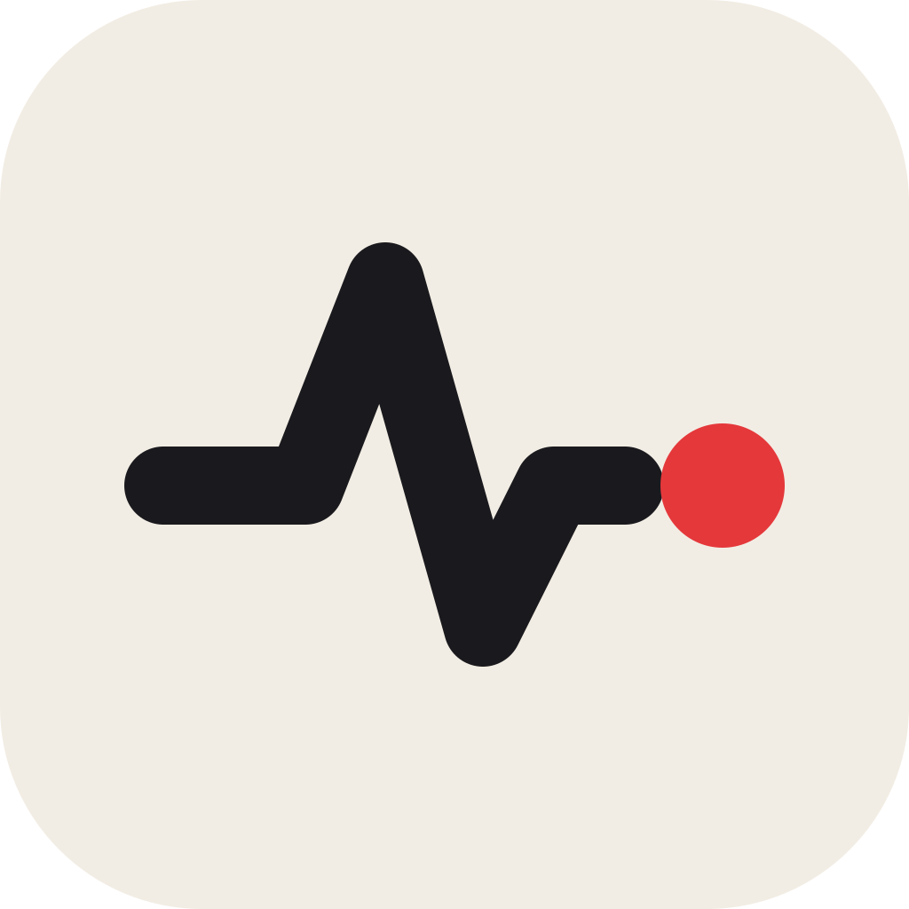

# Polso

Give your AI agents read access to your Apple Health data over MCP. Free and open source.

Polso is an iPhone app that reads the HealthKit data you choose and makes it available two ways:

- **On the phone.** While Polso is open, it serves an MCP endpoint on your local network.
- **On your own server.** Polso syncs in the background to a server you host, which serves the
  same MCP tools around the clock, whether or not your phone is awake.

Agents get summaries rather than raw samples: daily totals, trends, workouts and sleep.

## Project status

Early development. Nothing is ready to install yet.

[Contributing](CONTRIBUTING.md) · [Security](SECURITY.md) · [Licenses](LICENSE.md) · [Branding](TRADEMARKS.md)
